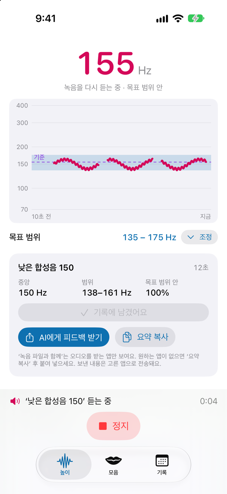
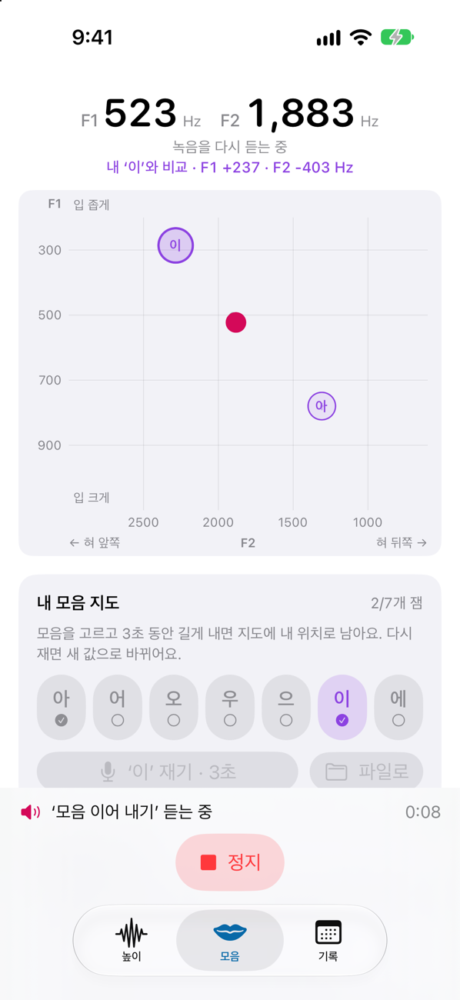
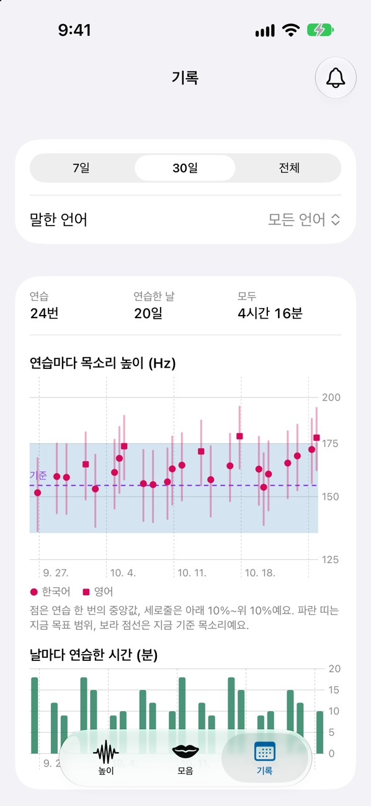

# 울림 (Ullim)

**원하는 목소리를 찾는 모든 사람을 위한 한국어 화자 기준 보이스 트레이닝 iOS 앱.**

'울림'은 공명(resonance)의 우리말이다. 목소리의 높이뿐 아니라 모음마다 입 안에서 울리는 공명을 함께 보자는 이 앱의 방향을 담았다.

> 개발 중인 개인 프로젝트다. 앱스토어에는 아직 없고, Xcode로 직접 빌드해 쓴다. 아이폰 실기기 확인이 남아 있다 ([확인 예정](#확인-예정)).

| [높이] 실시간 높이 그래프 | [모음] 모음 지도 | [기록] 날짜별 기록 |
|---|---|---|
|  |  |  |

<sub>iOS 시뮬레이터 화면. 소리는 합성음, [기록] 탭은 화면 확인용 가짜 기록이다.</sub>

## 해결하려는 문제
- **한국어 화자에게 맞는 연습 도구가 드물다.** 보이스 트레이닝 앱은 대부분 영어 화자 기준이다. 한국어에는 한국어의 모음(아·어·오·우·으·이·에), 문장 끝 억양, 연습 문장이 필요하다.
- **판정이 아니라 내 기준이 필요하다.** 목소리를 높이고 싶은 사람도, 낮추고 싶은 사람도, 발표·면접을 위해 안정된 목소리를 원하는 사람도 있다. "남성/여성" 점수 대신, 내가 정한 목표 범위와 지금 내 목소리를 비교해 보여 준다.
- **목소리는 민감한 정보다.** 녹음과 분석을 기기 밖으로 보내지 않고, 내보낼 때는 사용자가 직접 고른다.

## 주요 기능
- **[높이] 실시간 높이(F0) 그래프**: 지금 목소리 높이를 Hz 숫자와 꺾은선으로 보여 준다. 가로축은 ‘들려줄 길이’(10초~3분)만큼이고 오른쪽 끝이 지금이다. 그래프는 화면 위에 고정되어 대본을 넘겨 읽는 동안에도 보인다. 목표 범위 안은 굵은 선, 밖은 가는 회색 선이다. 세로축은 반음(로그) 눈금이라 낮은 목소리와 높은 목소리의 흔들림이 같은 크기로 그려진다.
- **내 목소리 기준 목표 범위**: 먼저 평소 목소리를 10초 재고(또는 녹음 파일로), 그 중앙값을 기준선으로 그린다. 처음 목표 범위는 기준 ±20 Hz이고 직접 옮길 수 있다.
- **녹음 → 듣기 → 다시 녹음 연습 고리**: ‘반복 루프 재생’을 누르면 정지할 때까지 녹음하고, ‘지금 들어보기’를 누르면 최근 10초~3분을 들려준 뒤 자동으로 다시 녹음한다.
- **한국어 연습 문장**: 직접 쓴 문장, 패턴으로 만드는 문장, 낭독 대본 200편. 문장마다 많이 나오는 모음을 표시한다.
- **[높이] 음량·공명 밝기 막대**: 그래프 아래에 지금 소리 크기(이 기기 마이크 기준 dBFS — 절대 데시벨이 아니다)와, 최근 2.5초 목소리의 둘째 포먼트(F2)가 내 기준보다 밝은 쪽인지 어두운 쪽인지를 보여 준다. 대본을 읽는 동안에도 볼 수 있다. 문장 속 공명은 말한 모음에 따라 달라지므로 같은 대본을 읽을 때 비교해야 뜻이 있다.
- **[모음] 모음 지도 (F1·F2)**: 모음을 낼 때의 첫째·둘째 포먼트를 실시간으로 지도에 찍는다. 내가 잰 모음 7개를 "내 모음 지도"로 저장해 비교한다. 비교 대상은 집단 평균이 아니라 내가 잰 값뿐이다.
- **[기록] 날짜별 기록**: 연습할 때마다 요약 숫자가 남고, 기간·언어별로 중앙값·범위와 연습 시간을 그래프로 본다. 직접 남긴 녹음은 다시 듣고, 두 녹음을 나란히 비교할 수 있다.
- **녹음 파일 불러오기**: 음성 메모 등의 녹음을 불러와 같은 방식으로 분석한다.
- **AI 피드백용 공유**: 요약 수치(원하면 녹음 파일도)를 iOS 공유 창으로 넘겨, 사용자가 고른 AI 앱에 붙여 넣을 피드백 요청문을 만든다.
- **목 건강**: 쉬지 않고 15분 연습하면 쉬어 가라고 알려 준다. 매일 연습 알림은 기본으로 꺼져 있다.

## 설계 원칙
1. **분석은 신호처리로.** 높이(F0)·포먼트·음량은 앱이 직접 계산한다 (YIN, LPC). AI는 보조 역할만 한다.
2. **네트워크 코드가 없다.** 녹음과 수치는 사용자가 iOS 공유 창에서 직접 고를 때만 앱 밖으로 나간다.
3. **성별 판정을 하지 않는다.** "남성/여성" 라벨·점수가 없다. 높이기·낮추기 어느 방향도 기본으로 가정하지 않는다.
4. **성대 건강을 지킨다.** 무리한 고음·저음 연습을 부추기지 않는다.
5. **한국어 화면, 아이폰 세로 화면 기준.**
6. **의료 기기가 아니다.** 진단·치료·재활 효과를 주장하지 않는다.

## 검증
| 무엇을 | 어떻게 | 결과 |
|---|---|---|
| 높이(F0) 검출 — YIN | 실제 음성 녹음 32개(약 18분)를 앱의 계산기와 Praat에 똑같이 넣어 프레임마다 비교 | 큰 오류(GPE) **0.15%**, 미세 오차 중앙값 **6.2센트**. 유성/무성 판정 일치 87.8% (소리 시작·끝 가장자리를 Praat보다 조금 더 놓친다) |
| 포먼트(F1·F2) — LPC | 정답을 아는 **합성 모음**(7개 모음, F0 100~350 Hz)으로만 검증 | F0 100·150 Hz에서 F1 최대 6.1%, F2 최대 4.6% 오차. 목소리가 높을수록(F0 ≥ 200 Hz) 낮은 F1이 배음 쪽으로 끌리는 LPC의 한계가 있어, 앱은 이때 점을 "불확실"로 표시한다. **실제 목소리 검증은 확인 예정** |
| 계산 규칙 | 단위 테스트 121개 (피치·포먼트 계산, 연습 고리 순서, 기록 저장, 그래프 축, 색 대비 등) | 모두 통과 (iOS 시뮬레이터) |

검증에 쓴 녹음과 프레임별 자료는 개인 음성이라 저장소에 올리지 않았다. 비교 도구는 `Tools/PitchValidation`, `Tools/FormantValidation`에 있다.

## 확인 예정
- 아이폰 실기기에서 실시간 꺾은선이 실제 목소리로 그려지는지 (지금까지 녹음·재생 음량과 공유 창만 실기기에서 확인했다). 확인 목록: [Docs/DEVICE_TEST.md](Docs/DEVICE_TEST.md)
- 포먼트(모음 지도)를 실제 목소리 녹음으로 검증하기
- 작은 목소리의 무음 판정 기준, VoiceOver 읽기, 연습 알림 도착

## 기술 스택
- Swift + SwiftUI, iOS 17 이상 (아이폰 세로 화면)
- 오디오: AVAudioEngine 입력 탭, AVAudioSession
- 신호처리: Accelerate (vDSP) — YIN 피치 검출, LPC 포먼트(Levinson–Durbin, 다항식 근 찾기 직접 구현)
- 그래프: SwiftUI Canvas + TimelineView (실시간), Swift Charts ([기록] 탭)
- 저장: SwiftData(숫자 기록) + 앱 Documents 폴더(직접 남긴 녹음, iOS 백업 제외)
- 외부 패키지 없음

## 빌드 방법
필요한 것: Xcode (Xcode 27.1과 iOS 27 시뮬레이터에서 확인했다. 더 낮은 버전은 확인하지 않았다), 실기기에 설치하려면 Apple 개발자 계정.

1. 저장소를 받는다.
2. 서명 설정 파일을 만든다. 실제 번들 ID와 팀 ID는 저장소에 올리지 않으므로, 프로젝트 맨 위 폴더(`Signing.xcconfig` 옆)에 `Signing.local.xcconfig`를 만들고 두 줄을 자기 값으로 적는다. 이 파일은 `.gitignore`에 들어 있다.
   ```
   VOICEPRACTICE_BUNDLE_ID = com.example.myullim
   DEVELOPMENT_TEAM = ABCDE12345
   ```
   - `VOICEPRACTICE_BUNDLE_ID`: 다른 앱과 겹치지 않는 번들 ID
   - `DEVELOPMENT_TEAM`: Apple 개발자 계정의 10자리 팀 ID (Apple Developer 웹사이트의 Membership 정보에서 볼 수 있다)
   - 시뮬레이터에서만 돌릴 거면 이 파일이 없어도 된다. 없으면 `Signing.xcconfig`의 자리표시자(`com.example.VoicePractice`, 팀 없음)로 빌드된다
   - Xcode의 Signing & Capabilities 화면에서 팀이나 번들 ID를 바꾸면 프로젝트 파일에 다시 적히므로, 이 파일로만 바꾼다
3. `VoicePractice.xcodeproj`를 Xcode로 열고 `VoicePractice` 스킴을 실행한다 (⌘R). 테스트는 ⌘U.

명령줄로는:
```bash
xcodebuild -project VoicePractice.xcodeproj -scheme VoicePractice -destination 'generic/platform=iOS Simulator' build
```
```bash
xcodebuild -project VoicePractice.xcodeproj -scheme VoicePractice -destination 'platform=iOS Simulator,name=<시뮬레이터 이름>' test
```

내부 프로젝트·타깃 이름은 `VoicePractice`이고, 홈 화면에 보이는 이름만 "울림"이다. 시뮬레이터에는 마이크 소리가 들어오지 않으므로, 소리 분석은 녹음 파일 불러오기로 확인할 수 있다.

## 문서
- [PROGRESS.md](PROGRESS.md) — 지금 상태, 다음 할 일, 알려진 문제
- [Docs/CHANGELOG.md](Docs/CHANGELOG.md) — 날짜별 작업 기록
- [Docs/FILES.md](Docs/FILES.md) — 파일마다 하는 일
- [Docs/DEVICE_TEST.md](Docs/DEVICE_TEST.md) — 아이폰 확인 목록

## 의료 기기가 아닙니다
울림은 목소리 연습을 돕는 도구이며 **의료 기기가 아니다.** 목소리 문제를 진단하거나 치료·재활 효과를 주지 않는다. 화면의 수치는 자동 측정이라 오차가 있다. 목이 아프거나 쉰 목소리가 오래가면 연습을 멈추고 이비인후과나 음성 언어 전문가와 상담하길 권한다.
